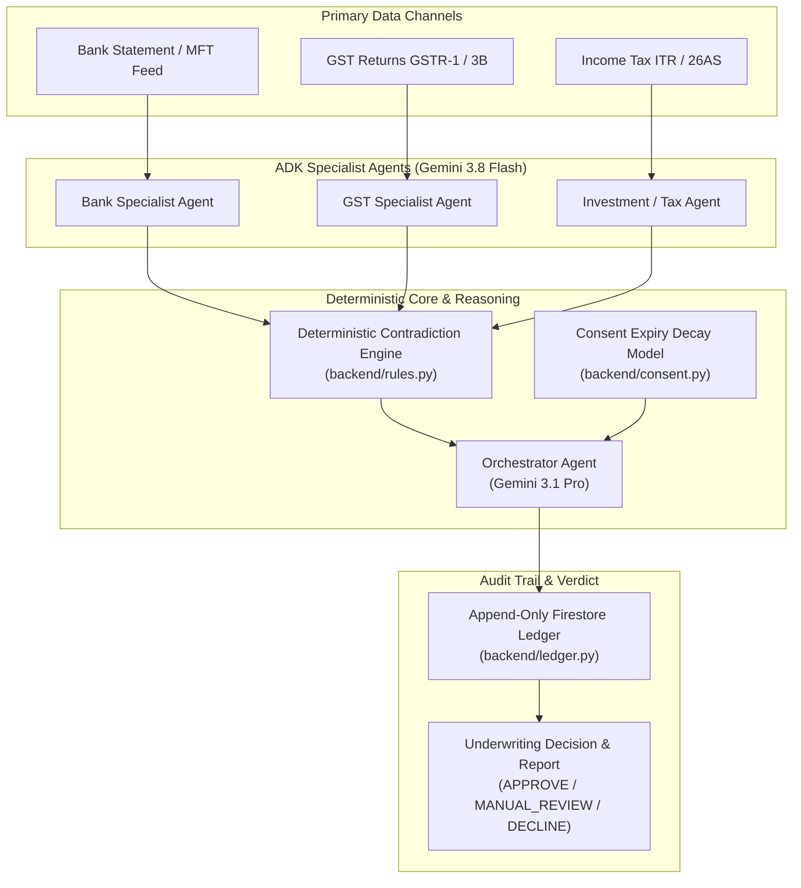

# TrueLedger

<p align="center">
  <strong>Tier-1 Institutional Credit Underwriting & Autonomous Forensic Audit Platform</strong><br>
  <em>Engineered for Credit Officers, Risk Analysts, and Underwriting Committees</em>
</p>

<p align="center">
  
  
  
  
  
  
</p>

---

## 🏛️ Executive Summary

**TrueLedger** is an enterprise-grade agentic financial forensics and credit underwriting platform built against India's **Account Aggregator (AA)** data model. Designed for institutional lenders, TrueLedger replaces opaque "black-box" credit scoring with an **immutable, append-only explainability ledger** where every underwriting decision is traceable to verified primary filings.

When evaluating a borrower, multi-source financial data—bank statement feeds (MFT), GST returns (GSTR-1 & 3B), Income Tax returns (ITR Form-16/26AS), and investment portfolios—are concurrently routed to dedicated **Specialist AI Agents**. An orchestration engine cross-verifies reported revenues against verified banking cash flows to detect **cross-source contradictions** (e.g., circular trading, revenue inflation, round-tripping), applies **consent-expiry confidence decay**, and produces a deterministic credit verdict with bidirectional ledger citations.

> **"The audit trail is the product, not a feature bolted on."**

---

## 📐 The 60 / 40 Architectural Split

TrueLedger balances institutional operational comfort with deep proprietary fraud detection:

```
┌─────────────────────────────────────────────────────────────────────────────┐
│                            TRUELEDGER PLATFORM                              │
├──────────────────────────────────────────────┬──────────────────────────────┤
│ 60% Institutional Core & Operational Shell   │ 40% Proprietary Forensic Moat│
├──────────────────────────────────────────────┼──────────────────────────────┤
│ • Responsive Dual-Tier Collapsible Sidebar   │ • Autonomous Multi-Agent     │
│ • Universal Command Palette (Ctrl/Cmd + K)   │   Swarm Telemetry & Traces   │
│ • Tabular Numerals (prevent layout jitter)   │ • Deterministic Contradiction│
│ • Masked Financial Identifiers (PAN/GST/Acc) │   Rule Engine (Precedence)   │
│ • Workspace / Environment Isolation          │ • Consent Expiry Decay Curve │
│ • Export Ledgers (.CSV) & Reports (.PDF)     │ • Cryptographic SHA-256 Logs │
└──────────────────────────────────────────────┴──────────────────────────────┘
```

---

## 🔄 User Journeys & State Routing Architecture

The platform strictly isolates customer-facing underwriting workflows from backend administrative telemetry:

```
[ CUSTOMER VIEW FLOW (Progressive Disclosure) ]
Step 1: Sign In ──► Step 2: Onboarding & Ingestion ──► Step 3: Agent Swarm Telemetry ──► Step 4: Final Dossier
 (Email / Demokit)   (Entity Name + 3 Gated Feeds)      (0-100% Animated Progress)        (Verdict, Discrepancies)

──────────────────────────────────────────────────────────────────────────────────────────────────────

[ ISOLATED DEVELOPER FLOW (Unindexed Route) ]
/app/dev-login  ──► Credential Gate (admin / TrueLedger2026!) ──► Append-Only Governance Console
 (Hidden Route)                                                    (SHA-256 Hashed Audit Events)
```

### Phase 1: Customer Progressive Disclosure Wizard

1. **Step 1: Customer Authentication Portal**
   - Branded institutional dark-mode interface (`bg-[#060913]`) with direct email/password login and a one-click **"⚡ Demokit Simulation Login"** for rapid underwriting evaluation.
   - Strict state machine validation: cannot bypass without authentication.

2. **Step 2: Onboarding & Multi-Channel Ingestion**
   - Interactive business entity name configuration (defaults to `Acme Hyperion Logistics Corp`).
   - Three gated verification vectors:
     - **GSTN Regulatory Gateway**: GSTR-1 & GSTR-3B filings.
     - **Income Tax Ingestion Framework**: ITR Form-16 & Form-26AS tax statements.
     - **Bank Statement Aggregator Feed**: Direct MFT bank transfer logs.
   - The primary CTA **"Proceed to Telemetry & Extraction →"** remains conditionally locked until all three channels are acknowledged and active.

3. **Step 3: Raw Data Telemetry & Multi-Agent Swarm**
   - Displays real-time specialist agent status cards (`Bank Statement Specialist`, `GSTN Regulatory Agent`, `Income Tax Intelligence Agent`).
   - High-fidelity animated progress track (0% → 100%) showing live trace tickers (`[BANK] Parsing MFT feed...`, `[GSTN] Cross-referencing turnover...`, `[DISCREPANCY] Anomaly flagged`).
   - Automatically transitions to Step 4 once verification reaches 100%.

4. **Step 4: Final Underwriting Verdict Dossier**
   - **Persistent Top Anchor Bar**: Displays Active Borrower ID, Algorithmic Verdict (`MANUAL REVIEW` / `APPROVE` / `DECLINE`), and Consent Haircut confidence indicator.
   - **Asymmetric Discrepancy Card**: Highlights variance between declared GST turnover (₹5.21 Cr) vs. actual bank inflows (₹3.79 Cr)—a **₹1.42 Cr (27.2%) structural variance**.
   - **Bidirectional Ledger Linking**: Direct jump cues linking contradiction markers to underlying transaction rows.
   - **Export Facilities**: Functional hooks for `Export Ledger (.CSV)` and `Download Audit Report (.PDF)`.

### Phase 2: Hidden Developer Governance Gateway

- **Zero Exposure**: All developer login triggers, admin consoles, and backend links are completely excised from customer views, menus, and the Command Palette.
- **Access Vectors**:
  - Direct URL: `http://localhost:8080/app/dev-login` (Express HTTP 302 redirect to `#view=dev_auth`).
  - Hash Anchor: `#dev-login` or `#view=dev_auth`.
  - Global Shortcut: `Ctrl + Shift + D`.
  - Discrete UI Trigger: Double-clicking the release badge (`v2.4.0-prod`) in the header.
- **Security Validation**: Unlocks only with credentials (`admin` / `TrueLedger2026!`).
- **Append-Only Governance Stream**: An immutable real-time log capturing every system event (customer logins, channel verifications, telemetry sweeps, CSV/PDF exports) paired with session IDs, timestamps, and SHA-256 block hashes. Includes an escape link back to the customer workspace.

---

## 🤖 Multi-Agent Orchestration Architecture



### Deterministic Precedence & Rules Matrix

1. **Precedence Invariant**: Deterministic rules execute before LLM reasoning. If a hard discrepancy is detected by rule logic, it cannot be overridden or hallucinated away by LLM commentary.
2. **Consent Expiry Decay Formula**:
   $$c(d) = \begin{cases} 1.0 & \text{if } d > 7 \text{ days} \\ \frac{d}{7.0} & \text{if } 0 < d \le 7 \text{ days} \\ 0.0 & \text{if } d \le 0 \text{ (Expired)} \end{cases}$$
   The weakest consent channel caps the total confidence score of the entire dossier.

---

## 📊 Ground Truth Benchmark Suite

TrueLedger includes 8 pre-seeded underwriting cases covering standard, fraudulent, and edge-case credit profiles:

| Case ID | Borrower Type | Verdict | Confidence | Key Primary Signal |
|:---|:---|:---:|:---:|:---|
| `BORROWER-CLEAN-001` | Prime Corporate | `APPROVE` | 0.95 | Clean ledger, zero contradictions, fresh consent |
| `BORROWER-CONTRADICTION-002` | Mid-Market Logistics | `MANUAL_REVIEW` | 0.50 | 27.2% revenue divergence: Bank credit ₹3.79 Cr vs GST ₹5.21 Cr |
| `BORROWER-STALE-CONSENT-003` | Manufacturing Unit | `DECLINE` | 0.00 | Expired banking consent ($d \le 0$), confidence penalized to zero |
| `BORROWER-FREELANCER-004` | Tech Contractor | `APPROVE` | 0.88 | Single-client inflow patterns, tax filings verified |
| `BORROWER-ROUNDTRIP-005` | Shell Trading Entity | `MANUAL_REVIEW` | 0.45 | Declared vs. actual volume gap, circular bank credits |
| `BORROWER-CLOSING-CONSENT-006` | Retail Chain | `MANUAL_REVIEW` | 0.43 | 3 days remaining on banking consent ($3/7$ decay haircut) |
| `BORROWER-SEASONAL-007` | Agri-Commodities | `MANUAL_REVIEW` | 0.52 | Q3 cash surge with historical seasonal divergence |
| `BORROWER-DOUBLE-FLAG-008` | High-Risk Exporter | `DECLINE` | 0.20 | Dual contradiction: GST turnover inflation + expiring consent |

---

## 📁 Repository Structure

```
TrueLedger/
├── agents/                      # Google GenAI ADK Specialist & Orchestrator Agents
│   ├── bank_agent.py            # Bank statement analyzer (Gemini 3.8 Flash)
│   ├── gst_agent.py             # GST return analyzer (Gemini 3.8 Flash)
│   ├── investment_agent.py      # Investment & mutual fund analyzer
│   ├── orchestrator.py          # Master cross-source synthesis agent
│   └── config.py                # Vertex AI client configuration
├── backend/                     # High-performance FastAPI Backend Service
│   ├── main.py                  # API routes, CORS, upload endpoints, replay feeds
│   ├── rules.py                 # Deterministic contradiction engine
│   ├── tools.py                 # Mathematical variance & threshold tools
│   ├── consent.py               # Linear consent decay algorithms
│   ├── extraction.py            # Multimodal document parsing (PDF/XLSX/CSV)
│   ├── ledger.py                # Append-only ledger formatting & storage
│   ├── pdf.py                   # ReportLab forensic PDF dossier generator
│   └── cases*.py                # Pre-loaded benchmark fixtures (<5ms response)
├── frontend/                    # Express + Vanilla JS & React Enterprise Frontends
│   ├── components/              # Reference Next.js/React enterprise components
│   │   └── TrueLedgerEnterpriseApp.tsx  # Full TypeScript progressive disclosure UI
│   ├── public/                  # Live production web assets
│   │   ├── desk.html            # Institutional Underwriting Desk UI
│   │   ├── style.css            # Dark fintech styling & animations
│   │   ├── app.js               # Progressive state machine & dev gateway
│   │   └── recorded/            # Pre-generated borrower replay JSON records
│   └── server.js                # Express static server & dev-login redirector
├── docs/                        # Architecture, data models, and deployment runbooks
├── scripts/                     # Case generators and synthetic test harnesses
└── tests/                       # Deterministic test suite (41/41 Pytest tests)
```

---

## 🚀 Quickstart & Local Setup

### Prerequisites
- **Python 3.11+** (Python 3.13 tested)
- **Node.js 20+** (Node.js 22 LTS recommended)

### 1. Clone & Setup Environment

```bash
git clone https://github.com/Aryanshanu/TrueLedger.git
cd TrueLedger

# Setup Python Virtual Environment
python -m venv .venv
# Windows PowerShell:
.\.venv\Scripts\Activate.ps1
# macOS/Linux:
source .venv/bin/activate

pip install -r requirements.txt
```

### 2. Run Deterministic Unit Tests

All core mathematical rules, consent models, and extraction logic can be verified locally without cloud credentials:

```bash
pytest tests/ -v
# Output: 41 passed in ~3.8s
```

### 3. Start Backend API Service (Port 8081)

```bash
# In Terminal 1:
$env:PYTHONPATH="."
.\.venv\Scripts\python.exe -m uvicorn backend.main:app --host 127.0.0.1 --port 8081 --reload
```
Verify health: `curl http://127.0.0.1:8081/health` → `{"status": "ok"}`

### 4. Start Frontend Application (Port 8080)

```bash
# In Terminal 2:
cd frontend
npm install
$env:BACKEND_URL="http://127.0.0.1:8081"
$env:PORT="8080"
node server.js
```

### 5. Access the Platform
- **Customer Portal**: Open [http://localhost:8080/desk](http://localhost:8080/desk)
  - Click **"⚡ Demokit Simulation Login"**
  - Verify all 3 onboarding channels and click **"Proceed to Telemetry & Extraction →"**
  - Watch the multi-agent swarm process live telemetry
  - Inspect the final forensic dossier, discrepancy flags, and export CSV/PDF reports
- **Developer Governance Console**: Open [http://localhost:8080/app/dev-login](http://localhost:8080/app/dev-login)
  - Unlock with `admin` / `TrueLedger2026!`
  - Review immutable append-only governance logs and SHA-256 event hashes

---

## ☁️ Google Cloud Deployment (Cloud Run)

TrueLedger is designed for containerized deployment to Google Cloud Run in `asia-south1`:

```bash
# Authenticate & set GCP project
gcloud auth login
export GOOGLE_CLOUD_PROJECT="your-project-id"
export GOOGLE_CLOUD_LOCATION="asia-south1"

# 1. Deploy FastAPI Backend
./infra/deploy_backend.sh

# 2. Deploy Frontend with Backend URL Injection
BACKEND_URL=$(gcloud run services describe trueledger-backend --region asia-south1 --format 'value(status.url)') \
./infra/deploy_frontend.sh
```

---

## 🔒 Security & Compliance

- **PII Masking**: Financial accounts, Permanent Account Numbers (PAN), and Tax IDs are masked by default (`•••• •••• 4912`) with audit-logged unmasking actions.
- **Append-Only Immutability**: Firestore ledger entries cannot be updated or pruned; every correction is appended as a superseding event.
- **Strict Role Separation**: Administrative and development capabilities are isolated behind `/app/dev-login` with credential validation and zero leakage to customer DOM bundles.

---

## 👥 Authors & Acknowledgments

- **Team**: The Outliers
- **Competition**: Google Cloud AI Builder Cup 2026 (APAC) — Banking, Financial Services, and Insurance (BFSI) Track.
- **License**: Apache 2.0
