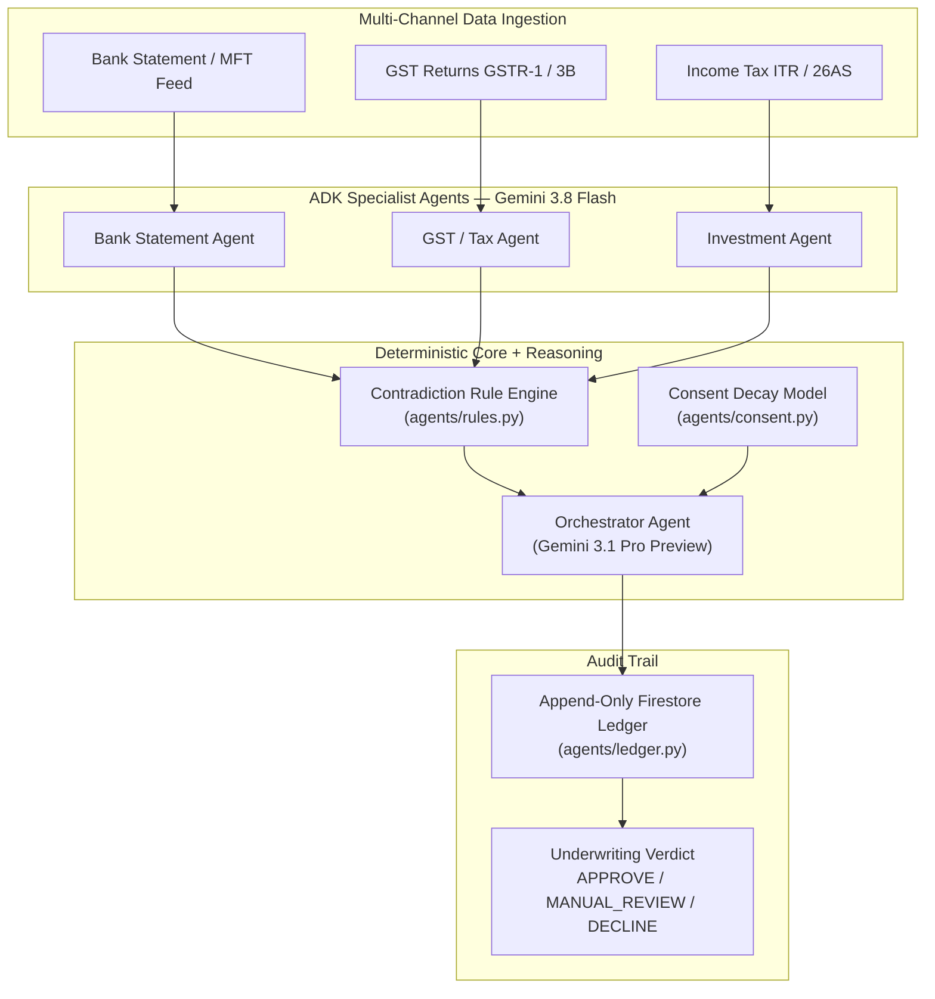

# TrueLedger

<p align="center">
  <strong>Institutional Credit Underwriting & Autonomous Forensic Audit Platform</strong><br>
  <em>Engineered for Credit Officers, Risk Analysts, and Underwriting Committees</em>
</p>

<p align="center">
  
  
  
  
  
  
</p>

> Built for **Google Cloud AI Builder Cup 2026 (APAC)** — Banking, Financial Services & Insurance track.
> Team: **The Outliers**.

---

## Executive Summary

**TrueLedger** is an enterprise-grade agentic financial forensics and credit underwriting platform built against India's **Account Aggregator (AA)** open-finance data model. It replaces opaque "black-box" credit scoring with an **immutable, append-only explainability ledger** where every underwriting decision is traceable to verified primary filings.

Multi-source financial data — bank statement feeds, GST returns (GSTR-1 & 3B), Income Tax returns (ITR / 26AS), and investment portfolios — are concurrently routed to dedicated **Specialist AI Agents** running in parallel. An orchestration engine cross-verifies reported revenues against verified banking cash flows to detect **cross-source contradictions** (circular trading, revenue inflation, round-tripping), applies **consent-expiry confidence decay**, and produces a deterministic credit verdict with bidirectional ledger citations.

> **"The audit trail is the product, not a feature bolted on."**

The core reasoning engine is built against the general open-finance consent pattern (India's AA, Australia's Consumer Data Right, Singapore's SGFinDex). Swap the data adapter, keep the engine, ship in a new market.

---

## Architecture

```
┌─────────────────────────────────────────────────────────────────────┐
│                         TRUELEDGER PLATFORM                         │
├──────────────────────────────┬──────────────────────────────────────┤
│  Institutional Workspace UI  │  Proprietary Forensic Engine         │
├──────────────────────────────┼──────────────────────────────────────┤
│  • 4-step progressive wizard │  • ADK ParallelAgent swarm           │
│  • 5-workspace command shell │  • Deterministic contradiction rules  │
│  • Per-workspace sub-views   │  • Consent expiry decay curve        │
│  • Dynamic entity routing    │  • Append-only Firestore ledger      │
│  • Command palette (⌘K)      │  • Bidirectional ledger citations    │
└──────────────────────────────┴──────────────────────────────────────┘
```



### Why the orchestrator is a custom agent, not a plain LlmAgent

The orchestrator (`agents/orchestrator_agent.py`) is a `BaseAgent` subclass that runs a hybrid pipeline:

1. **Deterministic rule table** (`agents/rules.py`) evaluates the four known contradiction patterns first — no model call, fully auditable.
2. **Inner LlmAgent** (`orchestrator_subtler_reasoning`) runs a second pass for subtler contradictions the rule table does not cover.
3. **Consent decay** (`agents/consent.py`) is applied: `c(d) = 1.0` if d > 7 days, `d/7` if 0 < d ≤ 7, `0.0` if expired.
4. Outcome is decided and written to both the explainability ledger and the final decision document.

This keeps the highest-stakes checks outside model judgement while still using LLM reasoning for what rules alone cannot catch.

---

## Google Cloud Components

| Component | Service | Notes |
|---|---|---|
| Agent runtime | ADK 2.10.0 (`google-adk`) | `LlmAgent`, `ParallelAgent`, `SequentialAgent`, custom `BaseAgent` |
| LLM — specialists | Gemini 3.8 Flash via Vertex AI | `location="global"` |
| LLM — orchestrator | Gemini 3.1 Pro Preview via Vertex AI | Global endpoint only; no regional option |
| Data store | Firestore (native mode) | `fi_data`, `consent`, `claims`, `ledger`, `decisions` |
| Backend | Cloud Run (FastAPI) | `asia-south1`, `min-instances=1` |
| Frontend | Cloud Run (Express, static) | `asia-south1`, `min-instances=1` |

---

## Frontend — 4-Step Progressive Wizard

```
Step 1: Sign In
  └── Step 2: Entity Intake + Benchmark Selection
        └── Step 3: Cross-Verification Telemetry (Agent Swarm)
              └── Step 4: Credit Assessment Dossier
                    └── 5-Workspace Command Shell
```

**Step 1 — Customer Authentication Portal**
- Dark-mode institutional interface. Any valid email + password accepted (demo mode).
- One-click "⚡ Instant Enterprise Login (Single Sign-On)" for rapid evaluation.

**Step 2 — Entity Intake & Data Channel Ingestion**
- 5 pre-built sector benchmark cases auto-fill entity name, PAN, GSTIN, and loan facility.
- Three data channel acknowledgements required before proceeding: GSTN, ITR, Bank Feed.
- "Proceed" button locked until all channels are active. On click, builds the `activeSession` snapshot that bridges entity identity into all workspaces.

**Step 3 — Agent Swarm Telemetry**
- Real-time animated progress (0% → 100%) as specialist agents process each channel.
- Live trace tickers: `[BANK] Parsing MFT feed...`, `[GSTN] Cross-referencing turnover...`, `[DISCREPANCY] Anomaly flagged`.
- Auto-advances to Step 4 at 100%.

**Step 4 — Credit Assessment Dossier**
- Persistent anchor bar: active entity, algorithmic verdict, consent decay haircut.
- Contradiction cards with bidirectional jump links to underlying transaction / filing rows.
- Export hooks: CSV ledger, PDF audit report.
- Navigation switches to the full 5-workspace shell.

---

## Frontend — 5-Workspace Command Shell

After completing the wizard, the sidebar unlocks five operational workspaces, each with sub-views:

| Workspace | Sub-views |
|---|---|
| **Dashboard** | Financial overview KPIs, GST compliance tracker, action queue (each action routes to the relevant sub-view) |
| **Client Space** | Onboarding profile · KYB verification · Document vault |
| **Income & Revenue** | Invoice pipeline · TDS / 26AS ledger · Monthly cashflow timeline |
| **Compliance Matrix** | GST lifecycle (GSTR-1 / 3B) · ITC offset analysis |
| **Asset Allocations** | Mutual fund portfolios · Capital allocation & pledgeability |

All workspaces derive their data from `activeSession` — the entity selected in Step 2 is reflected across every view. Sub-view selections persist when switching between workspaces.

---

## Benchmark Suite

Five sector cases are pre-loaded. The backend additionally carries 8 synthetic borrowers for end-to-end agent testing.

| Sector | Verdict | Confidence | Key Signal |
|---|---|:---:|:---:|
| Cement & Heavy Building Materials | MANUAL REVIEW | 0.50 | 27.2% GST vs bank revenue divergence |
| Agriculture & Agro-Trading | APPROVE | 0.95 | Clean ledger, fresh consent |
| Steel & Metallurgy Manufacturing | MANUAL REVIEW | 0.45 | Circular bank credit pattern |
| Financial Services & NBFC | APPROVE | 0.88 | Verified ITR + strong MF cushion |
| Chemicals & Crop Protection | MANUAL REVIEW | 0.43 | Closing consent (3d remaining, 3/7 decay) |

### Backend borrower cases (agent end-to-end)

| Case ID | Outcome | Confidence | Key signal |
|---|---|:---:|:---|
| `b_clean` | APPROVE | 0.95 | No contradictions, fresh consent |
| `b_contradiction` | MANUAL_REVIEW | 0.50 | `income_vs_revenue_divergence` |
| `b_stale_consent` | DECLINE | 0.00 | Expired consent → decay → 0 |
| `b_freelancer` | (recorded) | — | Thin file, SIP cushion |
| `b_roundtrip` | (recorded) | — | Deposit surges vs flat GST |
| `b_closing_consent` | (recorded) | — | 2d consent remaining |
| `b_seasonal` | (recorded) | — | Cyclical seasonal dip |
| `b_double_flag` | (recorded) | — | Turnover divergence + decaying consent |

---

## Repository Structure

```
TrueLedger/
├── agents/                     # Google ADK multi-agent pipeline
│   ├── bank_agent.py           # Bank statement specialist (Gemini 3.8 Flash)
│   ├── gst_agent.py            # GST return specialist (Gemini 3.8 Flash)
│   ├── investment_agent.py     # Investment / MF specialist (Gemini 3.8 Flash)
│   ├── orchestrator_agent.py   # Cross-source contradiction orchestrator (Gemini 3.1 Pro Preview)
│   ├── pipeline.py             # ParallelAgent + SequentialAgent wiring
│   ├── rules.py                # Deterministic contradiction rule table
│   ├── consent.py              # Linear consent expiry decay model
│   ├── ledger.py               # Append-only Firestore ledger writer
│   └── config.py               # Vertex AI client configuration (SPECIALIST_MODEL, ORCHESTRATOR_MODEL)
├── backend/                    # FastAPI backend service
│   ├── main.py                 # API routes, CORS, upload endpoints
│   ├── runner.py               # ADK pipeline runner
│   ├── extraction.py           # Multimodal document parsing (PDF/XLSX/CSV)
│   └── pdf.py                  # ReportLab forensic PDF dossier generator
├── frontend/                   # Express static server + production web assets
│   ├── server.js               # Express server with dev-login redirect
│   └── public/
│       ├── desk.html           # Institutional underwriting desk shell
│       ├── app.js              # Progressive state machine, all workspace renderers
│       ├── style.css           # Dark fintech styling
│       ├── enterprise_live_state.json  # Reference entity data (Kaveri Agro Foods base)
│       └── recorded/           # Verbatim captured API responses for 8 borrowers
├── data/synthetic/             # Synthetic borrower data generators
│   ├── borrowers.py            # 8 borrower definitions
│   └── generate.py             # AA-schema compliant data generator
├── infra/                      # Deployment & Firestore infrastructure
│   ├── seed_firestore.py       # Firestore seeder
│   ├── deploy_backend.sh       # Cloud Run backend deploy
│   ├── deploy_frontend.sh      # Cloud Run frontend deploy
│   └── cloudbuild.ci.*.yaml    # CI/CD triggers (push to main → auto-deploy)
├── scripts/
│   └── seed_cases.py           # Seeds all 8 borrowers (idempotent, updates consent timestamps)
├── docs/                       # Architecture, data models, deployment runbook
│   ├── ARCHITECTURE.md
│   ├── DATA_SCHEMA.md
│   ├── API.md
│   ├── TASKS.md
│   ├── DEPLOYMENT.md
│   └── NON_GOALS.md
└── tests/                      # Deterministic pytest suite (41/41, no GCP required)
```

---

## Quickstart

### Prerequisites

- Python 3.11+ (3.13 tested)
- Node.js 20+ (22 LTS recommended)

### 1. Clone & set up Python environment

```bash
git clone https://github.com/Aryanshanu/TrueLedger.git
cd TrueLedger

python -m venv .venv
# Windows PowerShell:
.\.venv\Scripts\Activate.ps1
# macOS/Linux:
source .venv/bin/activate

pip install -r requirements.txt
```

### 2. Run deterministic unit tests (no GCP credentials needed)

```bash
pytest tests/ -v
# Expected: 41 passed in ~3.8s
```

### 3. Start the backend API (port 8081)

```bash
# Windows PowerShell:
$env:PYTHONPATH="."
.\.venv\Scripts\python.exe -m uvicorn backend.main:app --host 127.0.0.1 --port 8081 --reload

# macOS/Linux:
PYTHONPATH=. uvicorn backend.main:app --host 127.0.0.1 --port 8081 --reload
```

Verify: `curl http://127.0.0.1:8081/health` → `{"status": "ok"}`

### 4. Start the frontend (port 8080)

```bash
# In a second terminal:
cd frontend
npm install

# Windows PowerShell:
$env:BACKEND_URL="http://127.0.0.1:8081"; $env:PORT="8080"; node server.js

# macOS/Linux:
BACKEND_URL=http://127.0.0.1:8081 PORT=8080 node server.js
```

### 5. Open the platform

Navigate to [http://localhost:8080/desk](http://localhost:8080/desk)

1. Sign in with any valid email address (demo mode — credentials are not validated).
2. Select a sector benchmark case (Deccan Cements, Kaveri Agro, etc.) — entity fields auto-fill.
3. Click the three data channel cards to activate them, then click **"Proceed to Cross-Verification →"**.
4. Watch the agent swarm telemetry animate to 100%.
5. Review the final dossier: verdict, consent decay haircut, contradiction flags.
6. Use the sidebar to explore all five workspaces.

> The recorded captures in `frontend/public/recorded/` power instant first paint without any GCP credentials. Click **"Re-evaluate Live"** in the dossier to trigger a real Vertex AI run (requires GCP credentials and a seeded Firestore).

---

## Cloud Run Deployment

```bash
# Authenticate
gcloud auth login
gcloud auth application-default login
export GOOGLE_CLOUD_PROJECT="your-project-id"

# Enable required APIs
gcloud services enable aiplatform.googleapis.com firestore.googleapis.com \
  run.googleapis.com cloudbuild.googleapis.com artifactregistry.googleapis.com

# Seed Firestore with synthetic borrower data
python -m scripts.seed_cases

# Deploy backend (uses cloudbuild.yaml for repo-root context — do not use --source backend/)
./infra/deploy_backend.sh

# Deploy frontend with live backend URL injected
BACKEND_URL=$(gcloud run services describe trueledger-backend \
  --region asia-south1 --format 'value(status.url)') \
./infra/deploy_frontend.sh
```

See `docs/DEPLOYMENT.md` for the full runbook including service account setup, CI/CD triggers, and cost guardrails.

---

## Security & Compliance

- **PAN / GSTIN / account masking**: Financial identifiers masked by default (`•••• •••• 4912`). Unmask is audit-logged.
- **Append-only ledger**: Firestore entries are never updated or deleted; corrections are appended as superseding events.
- **Consent decay**: The weakest-consent channel caps the entire dossier's confidence score. Expired consent produces `confidence = 0.0` regardless of financial health.
- **No real AA/Sahamati integration**: Synthetic data follows the real AA/Setu FI schema. No live AA endpoints are called anywhere in this repo.

---

## Authors

**Team: The Outliers**
Competition: Google Cloud AI Builder Cup 2026 (APAC) — BFSI Track
License: Apache 2.0
