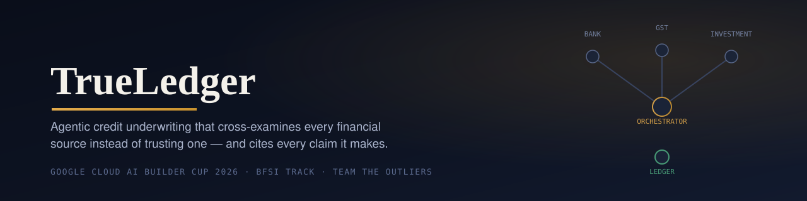
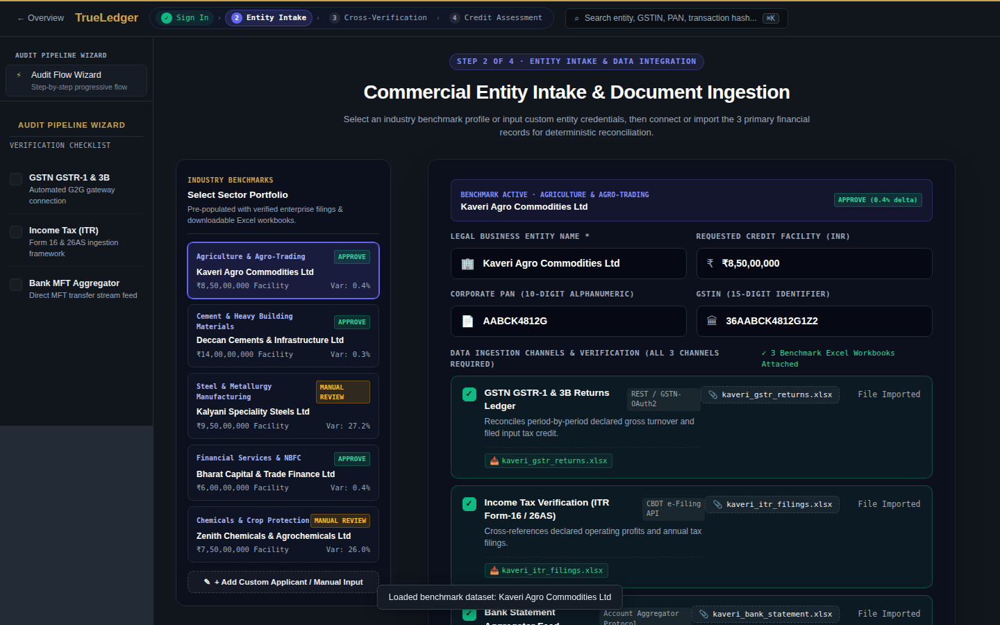
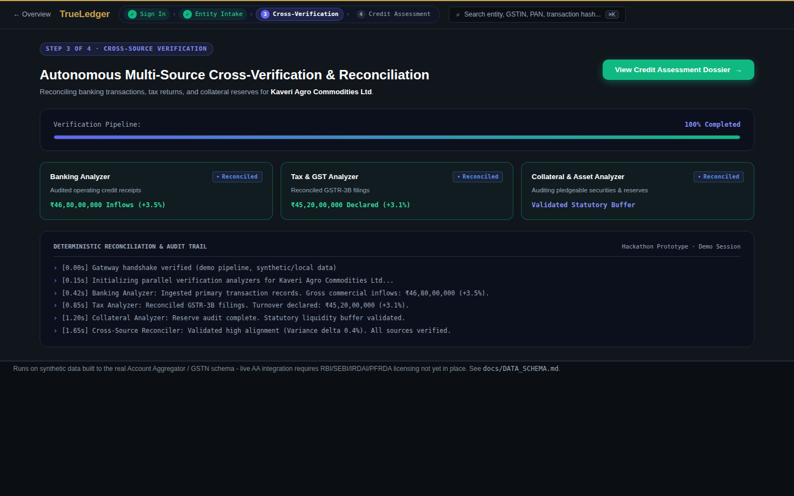
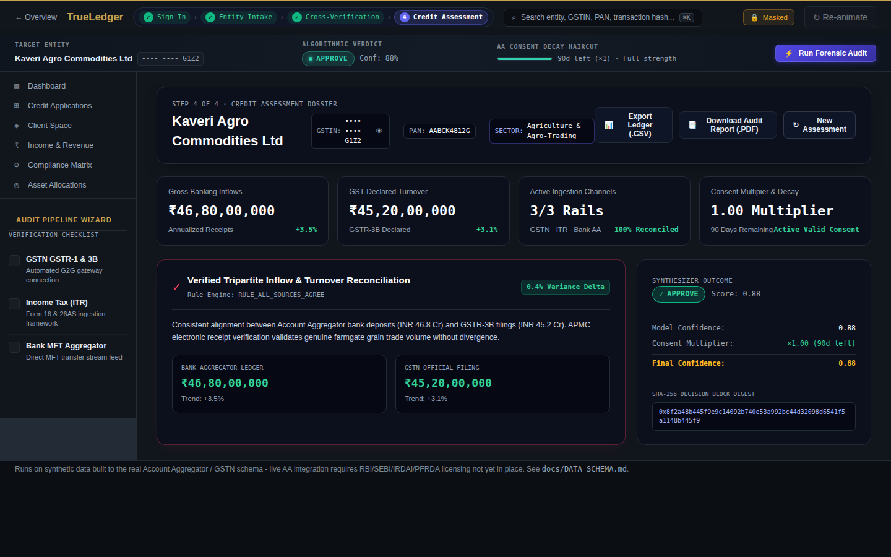
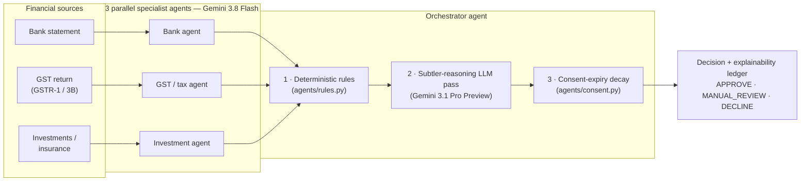
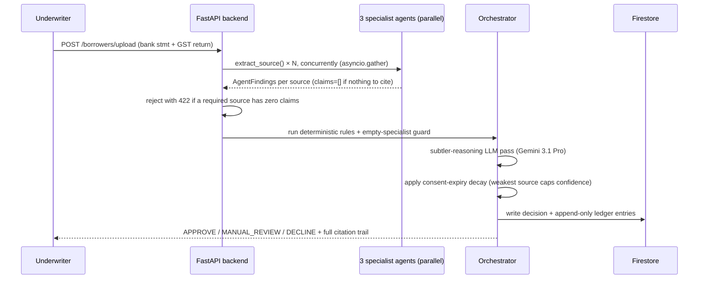

<p align="center">
  
</p>

<p align="center">
  <a href="https://github.com/Aryanshanu/TrueLedger/actions/workflows/ci.yml"></a>
  
  
  
  
  
  
</p>

<p align="center">
  Built for the <strong>Google Cloud AI Builder Cup 2026 (APAC)</strong> — BFSI track, by <strong>The Outliers</strong>.
</p>

<p align="center">
  <a href="#why-this-exists">Why</a> ·
  <a href="#see-it-in-action">See it in action</a> ·
  <a href="#how-it-thinks">How it thinks</a> ·
  <a href="#the-deterministic-rule-table">Rule table</a> ·
  <a href="#benchmark-results">Benchmarks</a> ·
  <a href="#quickstart">Quickstart</a> ·
  <a href="#repository-map">Repo map</a> ·
  <a href="#honesty--disclosure">Honesty &amp; disclosure</a>
</p>

---

> [!IMPORTANT]
> **Runs on synthetic data built to the real Account Aggregator / GSTN schema.** Live AA/Sahamati/FIP integration requires RBI/SEBI/IRDAI/PFRDA licensing not yet in place — see [`docs/DATA_SCHEMA.md`](docs/DATA_SCHEMA.md). What *is* real: `POST /borrowers/upload` reads an actual bank statement and GST return live with Gemini and runs them through the unmodified pipeline. No synthetic case is substituted for a real one.

## Why this exists

A bank evaluating a loan application reads the GST return. Separately, someone reads the bank statement. Separately again, someone looks at the investment portfolio. **Nothing reads all three against each other.**

That gap is exactly where fraud and credit risk hide. In a single quarter (Q2 FY26), GST authorities uncovered [₹15,851 crore in fake input-tax credit across 3,558 shell firms](https://theunderwrittenbyperfios.substack.com/p/the-sme-gold-rush-that-runs-through) — a mismatch between declared revenue and real cash flow that a cross-source check catches instantly, and a single-source review approves without a second look.

**TrueLedger closes that gap.** Three independent AI agents each read one financial source. An orchestrator cross-examines their findings against each other, applies a formula that decays confidence as a borrower's data-sharing consent nears expiry, and produces a decision with a citation for every number behind it — not a black-box score.

> *"The audit trail is the product, not a feature bolted on."*

The reasoning engine itself is designed to be adapter-agnostic: the consent-decay model and contradiction rules aren't coupled to any single data-source format. India's Account Aggregator is the only adapter actually implemented today.

---

## See it in action

<table>
<tr>
<td width="50%">

**The business case**


</td>
<td width="50%">

**Entity intake — pick a benchmark, 3 sources import automatically**



</td>
</tr>
<tr>
<td width="50%">

**Live cross-source reconciliation**



</td>
<td width="50%">

**The dossier — verdict, confidence math, and citations**



</td>
</tr>
</table>

---

## How it thinks



Each specialist writes its findings to its own session-state key; the orchestrator is a custom `BaseAgent` (not a plain `LlmAgent`) specifically so the **highest-stakes checks run as plain, testable Python before any model call** — the LLM pass exists only for the subtler contradictions that fixed rule table doesn't cover, never as a replacement for it.

<details>
<summary><strong>Sequence of a single <code>/borrowers/upload</code> request</strong> (click to expand)</summary>



</details>

---

## The deterministic rule table

Four cross-source contradiction rules, plus one structural guard — all plain Python in [`agents/rules.py`](agents/rules.py), none of them an LLM judgment call:

| # | Rule | Fires when | Action |
|---|---|---|---|
| 0 | **Empty-specialist guard** | A specialist's extraction returns zero claims | Force `manual_review` — an unexamined source must never read as a clean approval |
| 1 | **Income vs. revenue divergence** | Bank income stable/rising while GST revenue declines | Flag contradiction, cap confidence at 0.5 |
| 2 | **Declared vs. actual mismatch** | GST-declared turnover vs. bank credits diverge beyond 15% | Flag contradiction, force manual review |
| 3 | **Asset cushion vs. cash-flow volatility** | High cash-flow volatility + a claimed liquid cushion with no drawdown evidence | Flag contradiction |
| 4 | **Insurance coverage gap** | Coverage falls well short of the requested loan | Note as risk factor (soft, not a hard contradiction) |

And the consent-decay formula applied after the rules — one stale source caps the *whole* decision, it isn't averaged away by fresher ones:

$$c(d) = \begin{cases} 1.0 & d > 7 \text{ days remaining} \\ d / 7 & 0 < d \le 7 \\ 0.0 & d \le 0 \text{ (expired)} \end{cases} \qquad \text{final confidence} = \text{model confidence} \times \min_{\text{source}} c(d)$$

---

## Benchmark results

Five sector cases, pre-loaded in the Desk UI with downloadable sample Excel workbooks — these are the exact figures in [`frontend/public/app.js`](frontend/public/app.js):

| Sector | Entity | Verdict | Confidence | Signal |
|---|---|---|:---:|---|
| Agriculture & Agro-Trading | Annapurna Agro Commodities Pvt Ltd | ✅ APPROVE | 0.88 | Bank +3.5% ≈ GST +3.1%, 0.4% variance |
| Cement & Heavy Building Materials | Trisara Cements & Infrastructure Pvt Ltd | ✅ APPROVE | 0.82 | Bank −2.1% ≈ GST −2.4%, coordinated decline, 0.3% variance |
| Financial Services & NBFC | Aravind Capital & Trade Finance Pvt Ltd | ✅ APPROVE | 0.85 | Bank +1.2% ≈ GST +0.8%, 0.4% variance |
| Steel & Metallurgy Manufacturing | Virelion Specialty Metals Pvt Ltd | ⚠️ MANUAL REVIEW | 0.14 | Bank +5.4% vs. GST −21.8% — 27.2% divergence; consent 2 days from expiry (×0.29) |
| Chemicals & Crop Protection | Nexvara Chemicals & Agrochemicals Pvt Ltd | ⚠️ MANUAL REVIEW | 0.15 | Bank +7.8% vs. GST −18.2% — 26.0% divergence; consent 3 days from expiry (×0.31) |

All five are clearly fictional entities (not real companies) used to exercise the pipeline against a range of sectors and outcomes.

Both flagged cases show the *same signature*: bank income rising while GST-declared revenue falls — rule 1 firing exactly as designed, independently caught before any human reconciliation.

<details>
<summary><strong>Backend's own 8-borrower agent test suite</strong> (independent of the 5 Desk UI cases above)</summary>

| Borrower | Outcome | Confidence | Key signal |
|---|---|:---:|---|
| `b_clean` | APPROVE | 0.95 | No contradictions, fresh consent |
| `b_contradiction` | MANUAL_REVIEW | 0.50 | `income_vs_revenue_divergence` (+2.1% bank vs. −11% GST) |
| `b_stale_consent` | DECLINE | 0.00 | Expired consent → decay multiplier 0.0 |
| `b_freelancer` | recorded | — | Thin file, regular SIP cushion |
| `b_roundtrip` | recorded | — | Deposit surges vs. flat GST |
| `b_closing_consent` | recorded | — | 2 days of consent remaining → decay |
| `b_seasonal` | recorded | — | Cyclical seasonal dip |
| `b_double_flag` | recorded | — | Turnover divergence + decaying consent |

All 8 run live end-to-end against real Vertex AI + Firestore, both locally and on Cloud Run.

</details>

---

## Quickstart

<details>
<summary><strong>1 · Clone and install (Python)</strong></summary>

```bash
git clone https://github.com/Aryanshanu/TrueLedger.git
cd TrueLedger

python -m venv .venv
source .venv/bin/activate        # Windows: .venv\Scripts\Activate.ps1

pip install -r requirements.txt
```

</details>

<details>
<summary><strong>2 · Run the deterministic test suite — no GCP credentials needed</strong></summary>

```bash
PYTHONPATH=. pytest tests/ -v
```

Covers the rule engine, consent decay, the ledger, and the upload boundary — all mocked at the extraction/Firestore layer.

</details>

<details>
<summary><strong>3 · Start the backend (port 8081)</strong></summary>

```bash
# Needs real Vertex AI + Firestore credentials to actually evaluate a borrower:
gcloud auth application-default login
export GOOGLE_CLOUD_PROJECT=<your-project>
export VERTEX_AI_LOCATION=global

PYTHONPATH=. uvicorn backend.main:app --reload --port 8081
```

Verify: `curl http://127.0.0.1:8081/health` → `{"status": "ok"}`

</details>

<details>
<summary><strong>4 · Start the frontend (port 8080)</strong></summary>

```bash
cd frontend
npm install
BACKEND_URL=http://127.0.0.1:8081 PORT=8080 node server.js
```

Open **[http://localhost:8080/desk](http://localhost:8080/desk)**, sign in (any email — this is a demo gate, not real auth), pick a benchmark case, and step through the 4-step wizard. The recorded fixtures in `frontend/public/recorded/` power instant first paint with zero GCP credentials required.

</details>

---

## Repository map

```
agents/         ADK specialist agents + the orchestrator (rules.py, consent.py, ledger.py)
backend/        FastAPI service wrapping the agent pipeline (main.py, extraction.py)
frontend/       Express server + the Desk UI (desk.html, app.js, style.css)
data/synthetic/ Planted benchmark borrowers, built to the real AA/GSTN schema
infra/          Dockerfiles, Cloud Run deploy scripts, Firestore rules
docs/           Architecture, data schema, API contract, deployment runbook
tests/          Deterministic-logic test suite (no GCP credentials required)
```

---

## Deploying to Cloud Run

```bash
export GOOGLE_CLOUD_PROJECT=<your-project>
./infra/deploy_backend.sh
BACKEND_URL=$(gcloud run services describe trueledger-backend --region asia-south1 --format 'value(status.url)') \
  ./infra/deploy_frontend.sh
```

Both services default to `min-instances=0` (scale-to-zero) — pass `MIN_INSTANCES=1` only right before a live demo, then scale back down. An earlier always-on configuration briefly drove the project's GCP billing account to delinquency; see [`docs/DEPLOYMENT.md`](docs/DEPLOYMENT.md)'s **Cost and reliability guardrails** section for the full story and the budget-alert setup worth copying.

---

## Honesty & disclosure

This is a hard rule for everything in this repo, not a one-time disclaimer:

- **No real Account Aggregator, Sahamati, or FIP integration anywhere.** Every borrower is synthetic, built to the real AA/GSTN data schema — see [`docs/DATA_SCHEMA.md`](docs/DATA_SCHEMA.md).
- **No invented statistics.** Every number on the landing page traces to a cited, independently verifiable source (two examples: the ₹15,851 Cr GST-fraud figure above, and Sahamati's own FY26 AA-lending report).
- **No claimed regulatory compliance or certification this project hasn't actually earned.** A BFSI product overclaiming compliance is itself a compliance risk — see [`docs/NON_GOALS.md`](docs/NON_GOALS.md).
- **What *is* real**: live Gemini-based document extraction on an uploaded bank statement + GST return via `POST /borrowers/upload`, run through the exact same unmodified pipeline as the synthetic cases.

---

## Tech stack

| Layer | Technology |
|---|---|
| Frontend | Vanilla HTML/CSS/JS, Express (Node 22+), Cloud Run |
| Backend | FastAPI (Python 3.11+), Cloud Run |
| Agent framework | Google ADK 2.10.0 — `ParallelAgent` + a custom `BaseAgent` orchestrator |
| AI models | Gemini 3.8 Flash (specialists) · Gemini 3.1 Pro Preview (orchestrator reasoning) via Vertex AI |
| Data | Google Cloud Firestore — `fi_data`, `consent`, `claims`, `ledger`, `decisions` |
| CI/CD | Cloud Build (GitHub-triggered) · GitHub Actions (lint + 41 automated tests) |

---

<p align="center">
  <strong>Team: The Outliers</strong><br/>
  Google Cloud AI Builder Cup 2026 (APAC) — BFSI Track
</p>


---

## Enterprise Multi-Tenant SaaS Architecture

TrueLedger provides bank-grade, multi-tenant isolation, cryptographic audit trails, and resilient inference endpoints.

### API Headers & Authentication
All enterprise routes require tenant scoping:
- `X-Tenant-ID`: The unique identifier for the tenant workspace (e.g. `bank_hdfc`, `default_enterprise`). Enforces hard data isolation via `/tenants/{tenant_id}/borrowers/{borrower_id}` paths.
- `X-User-Role`: The caller's role (`admin`, `underwriter`, `auditor`, `compliance_officer`, `read_only`).
- `X-API-Key`: Required when `BACKEND_API_KEY` is configured in production.

### Enterprise API Endpoints
- `POST /v1/enterprise/borrowers/onboard` — Onboard a new borrower with strict field validation (PAN, GSTIN) and AES-256-GCM encrypted PII storage.
- `POST /v1/enterprise/borrowers/{borrower_id}/audit-run` — Trigger isolated, circuit-breaker-protected multi-agent evaluation.
- `GET /v1/enterprise/borrowers/{borrower_id}/ledger` — Fetch the append-only, Merkle-hashed audit ledger.
- `GET /v1/enterprise/borrowers/{borrower_id}/audit-export` — Export a regulatory-grade cryptographically verified compliance JSON bundle (`TRUELEDGER_CRYPTOGRAPHIC_AUDIT_SPEC_V1`).

### Security & Compliance Environment Variables
- `FIELD_ENCRYPTION_KEY`: 32-byte AES key (or base64-encoded) for AES-256-GCM field-level encryption with Authenticated Associated Data (AAD).
- `ALLOWED_ORIGINS`: Comma-separated list of allowed frontend origins (CORS lock down).
- `GEMINI_MAX_CONCURRENT`: Process-wide concurrency limiter for Vertex AI inference calls.
